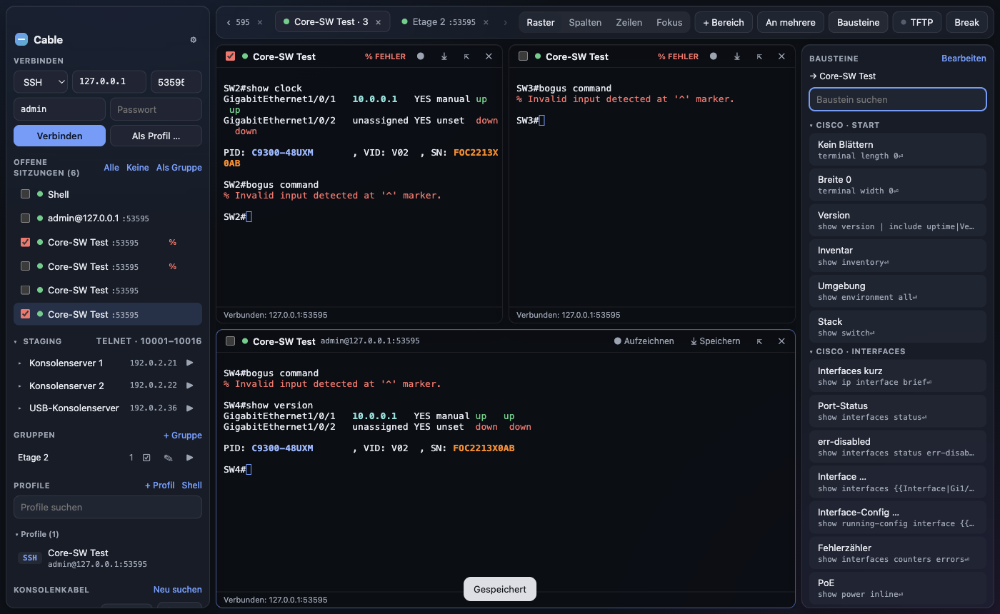
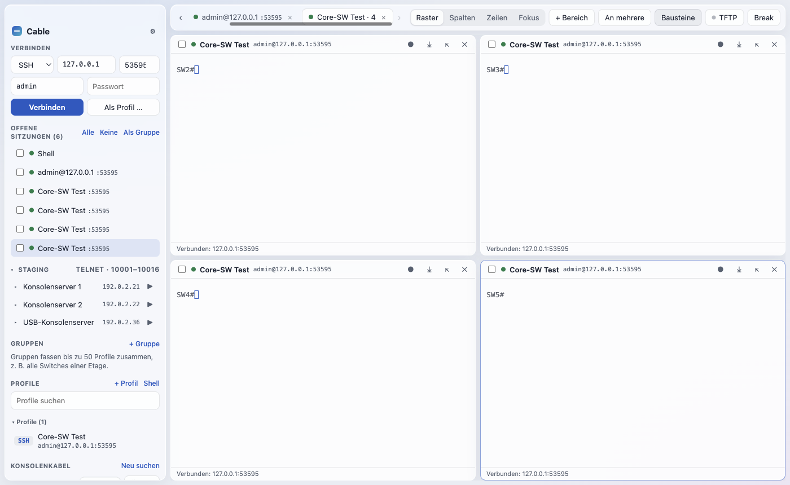

# Cable

**SSH, Telnet, Serial, Raw, lokale Shell und TFTP-Server in einem Fenster – eine PuTTY-Alternative für macOS,
gebaut für die Arbeit mit Switches, Konsolenkabeln und vielen Sitzungen gleichzeitig.**



## Kurz gesagt

Cable ist ein Terminal für Netzwerker. Ein Fenster statt fünf Programme: Konsolenkabel einstecken und
loslegen, per SSH auf zehn Switches gleichzeitig, eine Konfiguration an alle schicken, Images per TFTP
verteilen, die Ausgaben mitschreiben – ohne PuTTY, SecureCRT-Lizenz oder separaten TFTP-Server.

Läuft unter macOS (Apple Silicon und Intel), dazu auch unter Linux und Windows. Kostenlos, MIT-Lizenz.

## Was Cable anders macht als PuTTY

| | PuTTY | Cable |
|---|---|---|
| macOS | nur inoffiziell (GTK über Homebrew) | native App, hell und dunkel |
| Fenster | ein Fenster je Sitzung | Tabs mit bis zu 64 Sitzungen: Raster, Spalten, Zeilen, Fokus |
| An mehrere senden | nein | Befehle an ausgewählte, einen Tab oder alle Sitzungen – Ziele rot markiert |
| Gruppen | nein | bis zu 50 Profile mit einem Klick öffnen, z. B. alle Switches einer Etage |
| Befehlsbausteine | nein | über 50 Vorlagen (Cisco IOS/IOS-XE, NX-OS, ASA, Linux) mit Platzhaltern `{{Interface}}` |
| Hervorhebung | nein | IPs, Modelle, Seriennummern, `down`, `err-disabled`, `% Invalid`, Syslog-Stufen farbig |
| TFTP-Server | extra Programm | eingebaut, mit fertigen `copy tftp://…`-Befehlen |
| Konsolenkabel | COM-Port von Hand | `/dev/cu.*` wird erkannt, 9600 8N1 vorbelegt, Break für ROMMON |
| Passwörter | nicht speicherbar | nur auf Wunsch, verschlüsselt im macOS-Schlüsselbund |
| Aufzeichnen | Logdatei je Sitzung | je Bereich ein Klick, mit Zeitstempel je Zeile |
| Links | nein | `cable://ssh/admin@10.0.0.1` öffnet eine Sitzung aus Browser oder Gerätelisten |
| Umstieg | – | PuTTY-Sitzungen (`.reg`) und `~/.ssh/config` importieren |

## Installieren

Cable ist nicht von Apple signiert. Darum einmal den Quarantäne-Vermerk entfernen.

**Mit fertiger DMG** (Apple Silicon, M1 und neuer):

1. Unter [Releases](https://github.com/RateMySetup/cable-app/releases) die neueste `Cable-<Version>-arm64.dmg`
   laden, öffnen und Cable nach `Programme` ziehen. Für Intel-Macs gibt es noch keine DMG – dort aus dem
   Quellcode bauen.
2. Im Terminal:
   ```bash
   xattr -dr com.apple.quarantine /Applications/Cable.app
   codesign --force --deep -s - /Applications/Cable.app
   ```
3. Cable starten. Beim ersten TFTP-Start fragt macOS, ob Cable eingehende Verbindungen annehmen darf –
   erlauben, sonst erreichen die Switches den Server nicht.

**Aus dem Quellcode** (bekommt dann auch Updates über „Hilfe → Nach Updates suchen“):

```bash
xcode-select --install                  # einmalig, falls noch nicht da; dazu Node.js 22+ von nodejs.org
git clone https://github.com/RateMySetup/cable-app.git ~/Documents/cable
cd ~/Documents/cable
npm run setup                           # Abhängigkeiten + native Module für Electron
npm run install:local                   # bauen und nach /Applications installieren
```

Die meisten Cisco-USB-Konsolenkabel laufen ohne Treiber. Für Kabel mit Prolific- oder FTDI-Chip ggf.
den Treiber des Herstellers installieren.

### Optional: Staging-Konsolenserver

Wer feste Konsolenserver hat (z. B. Perle, Opengear, Cisco-Terminalserver mit je 16 Telnet-Ports), kann sie
als eigenen Bereich „Staging“ in die Seitenleiste holen: Server aufklappen, Klick auf 1–16 verbindet,
▶ öffnet alle Konsolen eines Servers in einem Tab.

Die Server stehen **nicht** im Code, sondern in einer eigenen Datei. Ohne Datei ist der Bereich ausgeblendet.

1. Vorlage [`docs/staging.example.json`](docs/staging.example.json) kopieren und anpassen
   (oder die fertige Datei von deinem Team nehmen):
   ```json
   {
     "title": "Staging",
     "firstPort": 10001,
     "consoles": 16,
     "servers": [
       { "name": "Konsolenserver 1", "host": "192.0.2.21" },
       { "name": "USB-Konsolenserver", "host": "192.0.2.36" }
     ]
   }
   ```
2. In Cable: **Ablage → Staging-Konsolen importieren (.json) …**

Cable legt die Datei als `~/Library/Application Support/Cable/staging.json` ab.
Wieder ausblenden: **Ablage → Staging-Konsolen entfernen**.

## Funktionen im Detail

| Bereich | Cable |
|---|---|
| Protokolle | SSH, Telnet (Echo, NAWS, Terminaltyp), Serial (Konsolenkabel), Raw TCP, lokale Shell |
| Verbinden | Getrennte Felder für Protokoll, IP/Host, Port, Benutzer und Passwort; „Als Profil …“ speichert die Angaben |
| Profile | Ordner, Farben, Notizen, Suche; Benutzer und Passwort je Profil (Passwort verschlüsselt im macOS-Schlüsselbund, nur auf Wunsch); Telnet und Serial antworten einmal automatisch auf „Username:“/„Password:“ |
| SSH | Passwort, Schlüsseldatei (auch mit Passphrase), SSH-Agent, keyboard-interactive (MFA), Jump-Host, Keepalive, „Alte Algorithmen erlauben“ für alte Cisco/HP |
| Tunnel | lokal (-L), remote (-R), dynamisch/SOCKS5 (-D), nur auf 127.0.0.1 |
| Anordnen | Bis zu 64 Bereiche je Tab: **Raster**, **Spalten**, **Zeilen**, **Fokus** (eine Sitzung groß, Statusliste mit „% Fehler“/„getrennt“). Bereiche einzeln schließen, per Ziehen umsortieren, in eigenen Tab lösen, alle Tabs zusammenführen |
| An mehrere | Offene Sitzungen per Häkchen auswählen; Ziel: **Ausgewählte**, **Dieser Tab** oder **Alle offenen**. Eingabezeile mit Verlauf (↑/↓) oder direkt tippen; Rückfrage vor mehrzeiligem Einfügen |
| Staging | Optional aus `staging.json`: Konsolenserver mit je N Telnet-Konsolen, Status farbig (grün verbunden, gelb verbindet, rot getrennt), ⌥-Klick öffnet eine zweite |
| Gruppen | Bis zu 50 Profile je Gruppe. ▶ öffnet alle in einem Tab – mit einem gemeinsamen Passwort für Profile ohne gemerktes |
| Bausteine | Über 50 Vorlagen mit Suche, mehrzeilig, Platzhalter `{{Name}}` oder `{{Name\|Vorgabe}}`; `{{TFTP-Server}}` wird mit der IP dieses Macs vorbelegt |
| Aufzeichnen | Je Bereich „● Aufzeichnen“ (Zeitstempel je Zeile, in `~/Documents/Cable Logs`) und „⤓ Speichern“ (ganzer Verlauf) |
| TFTP-Server | Ordner freigeben (Standard nur lesen), Port wählbar, Hochladen (Gerät → Mac) nur mit Häkchen und nie über bestehende Dateien. RFC 1350 mit blksize/tsize/timeout, Dateien über 32 MB |
| Sicherheit | Host-Schlüssel-Prüfung mit deutlicher Warnung bei Änderung; Passwörter nur verschlüsselt; Links öffnen nie ohne Bestätigung |
| Hervorhebung | IPv4/IPv6, Hardwaremodelle (`C9300…`, `MS225…`), Seriennummern, MAC; Fehler rot, Warnungen gelb, `up`/`connected` grün. Regeln editierbar |
| Import | `~/.ssh/config`, PuTTY-Sitzungen aus Windows (`.reg`-Export) |
| Links | `cable://ssh/admin@10.0.0.1:22`, `cable://telnet/host:2001`, `cable://serial/cu.usbserial-1410?baud=9600`, `cable://session/<Name>` |

Tastatur: ⌘K Verbinden-Feld · ⌘T Shell · ⌘N neues Profil · ⌘D weiterer Bereich · ⌘⇧W Bereich schließen ·
⌘1–⌘4 Raster/Spalten/Zeilen/Fokus · ⌘⇧B an mehrere · ⌘⇧R aufzeichnen · ⌘S Verlauf speichern ·
⌘⇧T TFTP · ⌘⇧S Bausteine · ⌘F suchen · ⌘⇧K Break · ⌘R neu verbinden · ⌘W Tab schließen · ⌘B Seitenleiste.



Vergleich mit PuTTY, SecureCRT, Termius, Royal TSX, Tabby, ZOC u. a.:
[`docs/RESEARCH-PUTTY-ALTERNATIVEN.md`](docs/RESEARCH-PUTTY-ALTERNATIVEN.md).

---

## Für Entwickler

Voraussetzungen: Xcode-Kommandozeilenwerkzeuge, Node.js 22 oder neuer.

```bash
npm run setup            # npm ci ohne optionale Pakete + native Module für Electron bauen
node node_modules/electron/install.js   # nur falls npm das Electron-Download-Skript übersprungen hat
npm test                 # Kernlogik, TFTP, echte SSH/Telnet/Raw-Verbindungen gegen Test-Server
npm run test:e2e         # Oberfläche mit echtem Electron (Screenshots in einem Temp-Ordner)
npm start                # direkt starten
npm run dist:mac:local   # nur release/mac-arm64/Cable.app (schnell, für diesen Mac)
npm run dist:mac         # release/Cable-<Version>-arm64.dmg (+ x64) und .zip
npm run install:local    # bauen, laufendes Cable beenden, nach /Applications installieren, neu starten
npm run update:local     # vorher git pull --ff-only
```

Jeder Build schreibt `dist/build-info.json` (Version, Commit, Quellordner). Die App liest das im Menü
**Hilfe**: „Über Cable“ zeigt den Commit, „Nach Updates suchen“ macht `git fetch` im Quellordner,
vergleicht mit `origin/main`, baut auf Wunsch im Hintergrund neu (Sitzungen bleiben offen) und fragt
danach, ob Cable neu starten soll. Protokoll: `~/Library/Logs/Cable/update.log`. Das geht nur bei
Installation aus dem Quellcode und nur unter macOS; unter Windows/Linux zeigt die App die Befehle an.

### Aufbau

```
src/core/        reine Node-Logik, ohne Electron testbar
  connections.js SSH (ssh2), Telnet, Raw, Serial (serialport), Shell (node-pty), Tunnel
  telnet.js      Telnet-Parser und -Verhandlung
  autologin.js   Antwort auf „Username:“/„Password:“ bei Telnet und Serial
  tftp.js        TFTP-Server (RFC 1350/2347–2349), nur im freigegebenen Ordner
  socks.js       SOCKS5 für dynamische Weiterleitung
  hostkeys.js    Host-Schlüssel (Trust on first use)
  store.js       Profile, Gruppen, Bausteine, Regeln, Einstellungen; Passwörter verschlüsselt getrennt
  highlight.js   Hervorhebung ohne Escape-Sequenzen zu stören; stripAnsi fürs Protokoll
  importers.js   ~/.ssh/config, PuTTY-.reg
  staging.js     Staging-Konsolenserver aus staging.json prüfen, Telnet-Sitzungen je Konsole
  cableurl.js    cable://-Links und Schnellverbindung (streng geprüft)
  logger.js      Sitzungsprotokoll
src/main/main.js Electron-Hauptprozess, IPC, Menü, Links, Aufzeichnung, TFTP
scripts/         build-info.js (Commit/Quellordner für die App), install-local.sh (bauen + installieren)
src/preload/     schmale Brücke (contextIsolation, sandbox)
src/renderer/    Oberfläche (xterm.js), ohne Node-Zugriff
test/            node --test; test/e2e/gui.e2e.js mit echtem Electron (xvfb-run unter Linux)
```

Daten: `~/Library/Application Support/Cable/` (`cable.json`, `secrets.json` verschlüsselt,
`hostkeys.json`, optional `staging.json`). Passwörter werden nie importiert oder exportiert.

Umstieg von „Kabel“ 0.1 (alter Name): Profile und Host-Schlüssel werden beim ersten Start aus
`~/Library/Application Support/Kabel/` übernommen; gemerkte Passwörter werden einmal neu abgefragt.

### Ideen für später

SFTP-Ansicht neben der Sitzung, Sitzungs-Sync über iCloud Drive (ohne Passwörter), Skripte/Makros mit
Warten auf Prompt (`expect`), Signierung mit Apple-Developer-ID, fertige DMG als GitHub-Release.

## Lizenz

[MIT](LICENSE)
